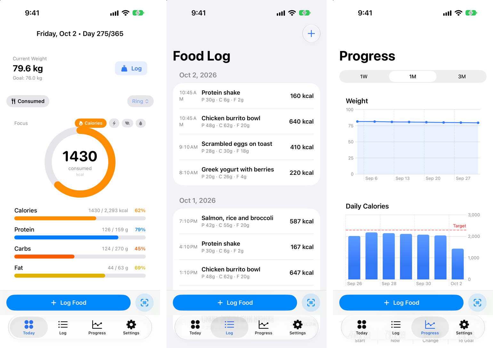
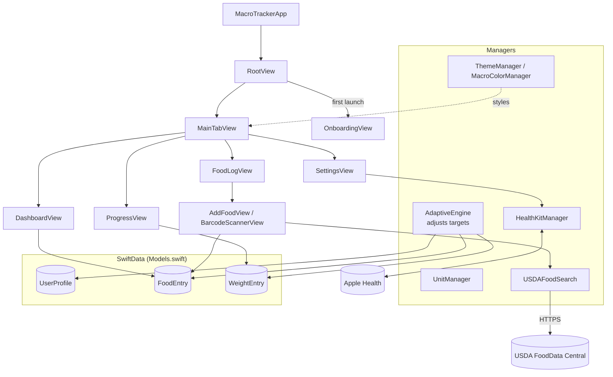

# Macro Lab

A SwiftUI + SwiftData iOS app for tracking food and macros, with an adaptive engine that adjusts targets from logged weight and intake.

## Screenshots

Today dashboard, food log and progress charts (iOS simulator, sample data).

## Architecture

More detail: [docs/ARCHITECTURE.md](docs/ARCHITECTURE.md)

## Features

- **Onboarding** – profile (age, sex, height, weight, goal weight, activity level) and a starting target from Mifflin-St Jeor.
- **Adaptive target** – once a week the app compares actual weight change with the change your target predicted (7,700 kcal ≈ 1 kg)
  and adjusts calories, with a short reason.
- **Today** – calories and macro progress for the day.
- **Log** – food entries by meal; add by USDA text search or by barcode scan (looked up on Open Food Facts).
- **Progress** – weight trend and history charts.
- **Apple Health** – reads weight, active energy and dietary energy; writes weight and dietary energy.
- **Settings** – units, theme and accent color.

## Run it

1. Open `Macro tracking - ios_swift.xcodeproj` in Xcode (iOS 17+, SwiftData).
2. Get a free key at <https://fdc.nal.usda.gov/api-key-signup/>.
3. Copy `Secrets.example.swift` to `Macro tracking - ios_swift/Secrets.swift` (gitignored) and put your key in it.
4. Run the app scheme on a simulator or device. Barcode scanning needs a real device camera.

## Path and purpose

| Path | Purpose |
|---|---|
| `Macro tracking - ios_swift/MacroTrackerApp.swift` | App entry; creates the shared managers and the SwiftData container |
| `Macro tracking - ios_swift/Models.swift` | `UserProfile`, `FoodEntry`, `WeightEntry`, `MacroTargets` and the `Sex`, `Goal`, `ActivityLevel`, `MealType` enums |
| `Macro tracking - ios_swift/AdaptiveEngine.swift` | Weekly comparison of actual vs expected weight change and the new calorie target |
| `Macro tracking - ios_swift/USDAFoodSearch.swift` | FoodData Central search and nutrient mapping (per 100 g) |
| `Macro tracking - ios_swift/BarcodeScannerView.swift` | Camera barcode scanning and Open Food Facts product lookup |
| `Macro tracking - ios_swift/HealthKitManager.swift` | HealthKit authorization, reads and writes |
| `Macro tracking - ios_swift/UnitManager.swift` | Metric/imperial conversion and formatting |
| `Macro tracking - ios_swift/ThemeManager.swift`, `MacroColorManager.swift` | Accent/theme and per-macro colors |
| `Macro tracking - ios_swift/Views/` | Root, onboarding, tabs, dashboard, log, add food, progress, settings |
| `Secrets.example.swift` | Template for the gitignored `Secrets.swift` holding the USDA API key |

## Design patterns

- **SwiftData as the single store.** Views query `UserProfile`, `FoodEntry` and `WeightEntry` directly; there is no separate
  persistence layer.
- **Stateless engine.** `AdaptiveEngine.recalculate` is a static function over a profile and weight entries and returns a new
  target and message, so it is easy to test.
- **Shared singletons injected through the environment.** `UnitManager`, `HealthKitManager` and `ThemeManager` are created once
  in the app and passed down as environment objects and values.
- **Gated adjustment.** A target changes at most weekly and only with two or more weight entries since the last change.
- **Secrets kept out of source.** The API key lives in a gitignored file with a committed template.
- **Per-100 g normalisation.** USDA results are mapped to per-100 g values once at the API boundary.
